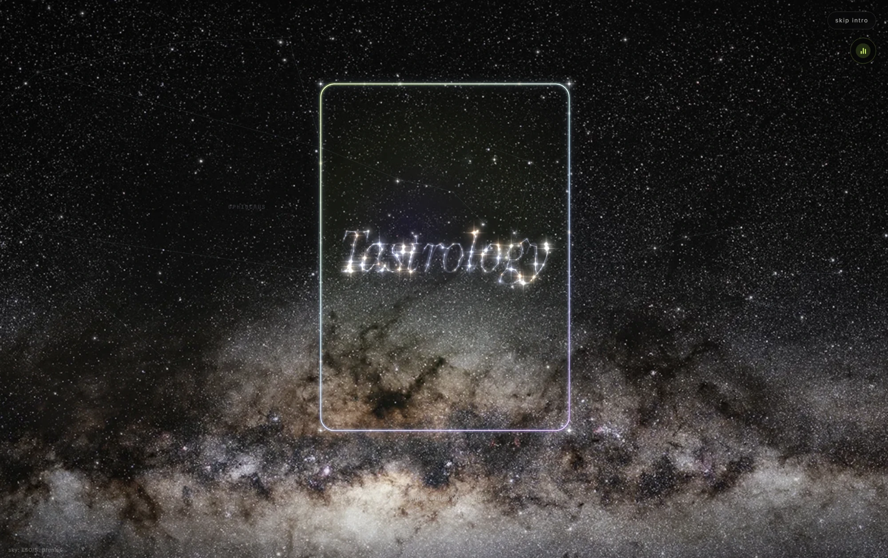
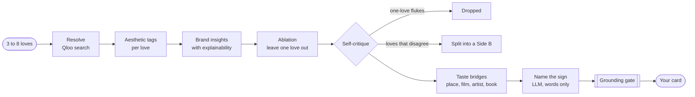
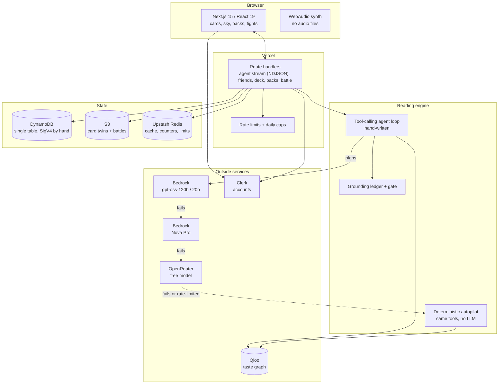

<div align="center">


# Tastrology

### Astrology, but with receipts.

**Your taste deserves a constellation.** Name 3 things you love; an AI agent charts them through **Qloo's taste graph** into a star sign card worth collecting. Every star is a real, Qloo-verified brand, and each one comes with proof of why it's there.

<br />

<a href="https://tastrology.vercel.app"></a>
&nbsp;
<a href="https://qloo.devpost.com"></a>

<br /><br />

<a href="https://tastrology.vercel.app"></a>

<sub>The opening of the live site: your name in the stars, before the card is minted.</sub>

<br /><br />


</div>

---

## The short version

People love their star signs. But a sign comes from your birthday, and you didn't choose that.

You did choose your taste. The films you rewatch, the artist on repeat, the café you keep going back to. That's you. And Qloo knows how taste connects: people who love *Blade Runner 2049* and Berghain really do drift toward the same jackets.

So Tastrology turns your taste into a star sign. Name three loves, and an AI agent maps them through Qloo into a constellation of real brands on a card you keep.

AI loves to make stuff up. This one can't. Every reading ends with:

> **Grounding gate: 10/10 brands verified against Qloo, 0 invented.**

There's also a panel that asks a plain LLM the same question with no Qloo, so you can see the difference for yourself.

Then you share the card, scan a friend's, and fight. Your first reading doesn't even need an account.

## What you get

**A card that is actually yours.** A holographic collectible you can drag, spin and flip, with a print-grade back, a verify code and a QR. Every card has a public home at `/c/<code>` and a server-side twin, so nobody can fake one.

**Receipts, literally.** A thermal-printer receipt of your reading, plus "Show the math": the attribution matrix of which love moved which brand, measured, not guessed.

**A sky of friends.** Your friends live in a constellation around you. Their stars move closer the more you fight; their colour climbs from teal to violet to lime as friendship levels up. New friends are born on screen: the cloud collapses, flashes, ignites and the bond draws in. Tap a star and the sky flies to them; their bio waits under scratch-off foil.

**Fights.** Any two cards can battle on a deterministic engine. Friends can challenge each other for free or stake Stardust on a blind draw from each deck. Accepting is required, stakes sit in escrow, and the winner takes both.

**An economy with rules.** Retire a card and it burns into Stardust (the particles really fly into your counter). Stardust buys Battle Packs (Star, Flare, Supernova, with published odds), recasts and living sigils. One pack a day, no exceptions.

**It sounds like something.** Every tear, scratch, flake and reveal is synthesized live in WebAudio. There isn't a single audio file in the repo.

## How a reading works

This is not a chat wrapper. It's a glass-box agent: every step is a real Qloo call you can open and inspect while it streams, with a timestamp on each one.

The short of it: you watch it think, it figures out which love brought which brand by taking them away one at a time, and anything Qloo didn't name gets bounced at the door.



1. **Resolve** each love to a Qloo entity.
2. **Tag** each love with its aesthetic, from Qloo's tag graph.
3. **Ask for brands** that share the taste, with per-love explainability.
4. **Ablate.** Re-query once per love with that love removed. The drop in affinity is how much that love earned each brand. That's the attribution matrix.
5. **Critique itself.** A brand held up by a single love is a fluke and gets cut. Two loves that pull in opposite directions aren't averaged into mush; they become a Side A and a Side B.
6. **Bridge** into a place, a film, an artist and a book that complete the picture.
7. **Name it.** Only now does the LLM speak: it names the sign and phrases the "because you love..." lines.

**The grounding rule.** The LLM never picks a brand. A `GroundingLedger` records everything Qloo returned during the run, and a final gate removes anything that isn't in it. If the model invents a brand, it simply doesn't appear. It's enforced in `lib/grounding.ts` and checked by tests against every demo persona.

## Architecture



A few pieces I'm proud of:

- **No AWS SDK.** DynamoDB and S3 are called over HTTPS with AWS Signature V4 written by hand (`lib/sigv4.ts`). It cuts cold starts and bundle size, and nothing is hidden.
- **One DynamoDB table for everything.** Accounts, decks, wallets, ledgers, friends, requests, fights, card owners and usernames are all access patterns on a single table. Money-like moves (stakes, packs, renames) are conditional transactions with write-once ledger rows, so a retry can never charge twice.
- **Four planners deep.** The agent tries Bedrock's gpt-oss-120b, then 20b, then Nova Pro, then a free OpenRouter model, and if all of them are down, a deterministic planner finishes the same run with the same tools. A user never sees a blank screen because a model had a bad day.
- **Speculative execution.** While the LLM is deciding what to do next, the likely next Qloo step is already running. Its trace events are held back until the model actually asks for it, so runs stay fast without faking the model's choices.
- **Rarity you can audit.** A card's rarity is a keyed hash of the account and the paid run, so reloading can't re-roll it. The season key's sha256 is published on `/odds` before the season and revealed after it, so anyone can check that nobody rigged the draws.
- **Real-time without sockets.** Every write that touches you bumps one counter. Pages poll that single number (cheaply, and faster right after something happens) and only reload when it moves. Challenges land on both screens at once, and online status comes from the same heartbeat.
- **Demo personas cost nothing.** The landing page's sample readings are recorded once and replayed forever, so a viral spike never touches the Qloo quota.

## The story

I built this alone in five days, from `create-next-app` to a live site, with a budget of zero. Before writing any code I wrote one rule down: every star comes from Qloo, in that run, and the app has to prove it.

That budget shaped everything. No paid model, so the planner had to survive free-tier rate limits: when the LLM gets throttled mid-run, a circuit breaker pauses it and the deterministic autopilot quietly finishes the reading. No paid database, so every read and write had to be counted; the friends page is three reads and live updates are one tiny counter. No paid domain, so Clerk stays on a development instance, its badge hidden, with inactive accounts pruned by hand to stay under the cap.

Some of the best features came from things breaking in front of me.

- **The free LLM ran out on day two.** OpenRouter's free tier is 50 requests a day, and one reading eats several. I moved the planner to Bedrock and chained four providers behind circuit breakers.
- **"The Daft Who Bakes Scones."** A real output: the model chopped "Daft Punk" in half. Sign names now get repaired against the real seed, so even the title is grounded.
- **A demo persona lost three of its five loves** to a burst of Qloo rate limits, with no error. I only noticed because the card felt boring. Now there's jittered backoff, a concurrency cap, and a log line for every dropped seed.
- **I could forge cards in my own app.** The server saved whatever the browser sent. Now cards are registered server-side, hash-bound, and write-once in S3, enforced by IAM.
- **Sharing took about ten rounds** of phone testing: a blank Snapchat preview, a constellation that exported as a black triangle, Safari eating the art. Every card now draws its own preview image.
- **The first phone test.** A challenge sent from my laptop was accepted on my phone, and the laptop never showed the fight. So polling now runs hot for a minute after anything happens, then cools off, and a fight you started opens on your screen the moment it settles.
- **The QR that led nowhere.** Scanning my own card from another phone landed on a page that said almost nothing. Now a scanned card knows its owner: you can add them, read their card, or answer with one of your own.
- **"Why is it recommending lingerie?"** Qloo doesn't know who it's talking to. So readings now carry who they're for, taken from your private profile and never from the request. It steers the Qloo query, and a filter keeps women-only items away from anyone who didn't say they want them. The cached reading for one audience is never handed to another.
- **One trackpad fling skipped the whole intro.** Desktop scrolling now has its own pacing, so the intro reads the way it does on a phone.
- **Usernames without leaking emails.** People share cards before they ever pick a name, so the username is asked for right after sign-in, kept in sync with Clerk, and nothing that leaves the server carries an email, a real name or an account id.
- **A chaos pass before launch.** I fired junk at every endpoint and found a race where two renames at the same instant could both ride the free one, and public lookups that could be scraped in bulk. Both are closed, with tests.

## Built to be trusted

Collectible, gamified, social: that's three ways to get into trouble. So the boring parts got real attention.

- **Grounded output.** Every brand on a card came from Qloo in that run.
- **Honest odds.** Every pack table is published before you open it, rarity is commit-and-reveal, and Stardust has no cash value.
- **Privacy by default.** IPs are salted and hashed before they reach a rate limiter. No ads, no trackers, no analytics cookies. Gender is optional, private and only used to filter your own picks.
- **Real deletion.** Closing your account from the Account page deletes everything: deck, wallet, ledger, friends and username, and returns any Stardust riding on open fights.
- **Limits everywhere.** Every API route is rate limited; readings, LLM calls and fights have daily caps, so a bad actor can't run up a bill.
- **Written policies.** Privacy, terms and cookie pages written for India's DPDP Act, with an age gate before sign-up.
- **Qloo's rules respected.** No Qloo response data is committed to this repo. Mock mode runs on a small hand-made graph with the same shape.

## By the numbers

| | |
|---|---|
| Built in | 5 days, solo |
| Commits | 190 |
| Lines of TypeScript | about 35,000 |
| Tests | 187, across 32 files |
| AWS SDKs | 0 |
| Audio files | 0 |
| Budget | $0 |

## What's next

**Sponsored stars that can't be bought.** A brand only shows up if Qloo already put it in your sky. A sponsor can light that star up (a frame, a limited drop) but can't buy its way in. The grounding gate enforces that. In return, ablation tells brands which loves pull people their way, as anonymous cohorts: "people whose sky has Tame Impala and Ghibli", not "women 18–24".

**A weekly taste census.** The anonymous mint counters already exist. At scale, they show how culture is moving.

**Taste twins.** Overlay two skies. The compatibility scoring already runs between friends; next it finds strangers.

**Seasons and real cards.** Skies that re-read each season, and printed cards whose QR opens the verified original.

**The boring stuff:** Playwright and CI, load tests, a fallback for when Qloo is down, and Web Push.

## Run it

```bash
git clone https://github.com/NemesisWaVe/Tastrology.git
cd Tastrology
cp .env.example .env.local   # mock mode works with no keys at all
npm install
npm run dev                  # http://localhost:3000
npm test
```

Mock mode needs nothing: a synthetic taste graph and the deterministic planner run the full experience offline.

To go live, fill in `.env.local` (`.env.example` documents the Qloo, LLM, cache and S3 settings):

| What | Variables |
|---|---|
| Qloo | `QLOO_MODE=live`, `QLOO_API_KEY` |
| LLM chain | `LLM_*`, then optional `LLM2_*` and `LLM3_*` (any OpenAI-compatible endpoint or Bedrock) |
| Cost caps | `LLM_DAILY_MAX`, `LLM_MAX_TOKENS`, `DAILY_RUNS_MAX` |
| Accounts | Clerk keys |
| Storage | `DDB_*` (DynamoDB), `S3_*` (card twins), `UPSTASH_*` (cache and limits) |
| Economy | `CREDITS_ON`, `ROLL_SECRET` |

## Stack

Next.js 15 (App Router) · React 19 · TypeScript · Tailwind CSS v4 · Motion · Lenis · Clerk · Amazon Bedrock · Qloo · DynamoDB · S3 · Upstash Redis · Vercel · Vitest

## License

[AGPL-3.0](LICENSE). If you run a modified version as a service, share your changes.

<div align="center">
<br />

**[Mint your card](https://tastrology.vercel.app).** Your taste has been saying things about you. Come see what.

</div>
